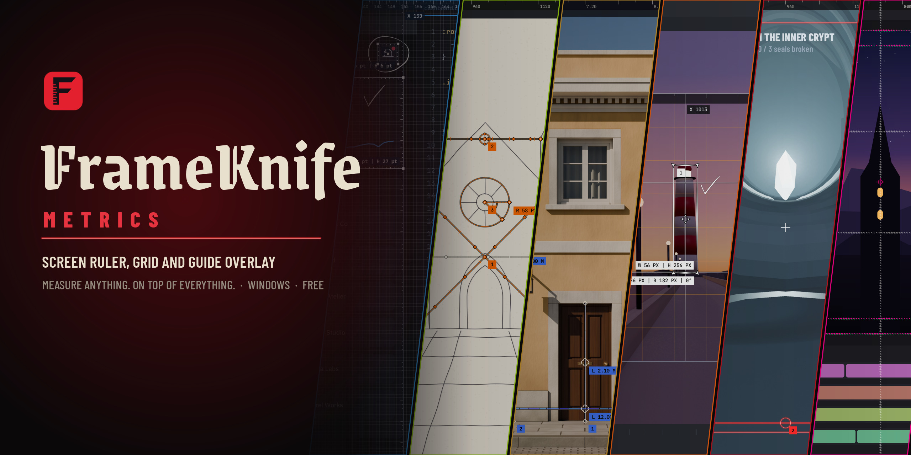

  

https://github.com/user-attachments/assets/aa68201d-df81-4d6e-94b4-52f645977896

<h1 align="center">FrameKnife Metrics</h1>

  <b>Screen ruler, grid and guide overlay for Windows.</b> 
  Measure anything. On top of everything.

  

  

  
  
  
  

FrameKnife Metrics is a free, portable desktop tool that lays a transparent overlay across your screen, always on top of every window. On it you place pixel-exact lines, boxes, angle crosses, symmetry mirrors, compasses, ruler guides, grids and aspect-ratio frames, and write notes with a fine pen. Clicks on empty areas pass straight through to the app underneath, so you keep working in your browser, game, 3D app, photo viewer or editor while the measurements stay where you put them. Every layout can be saved and brought back with Ctrl+1 to Ctrl+9, from any app.

## What FrameKnife Metrics does

- **Measures in physical screen pixels.** Every element shows its size as you drag it: a line its length (`L 280 px`), a box its width and height (`W 48 px | H 48 px`), a cross its two arms and its angle (`A 933 px | B 933 px | 45°`), a mirror the distance between mirrored points (`D 584 px`), a compass its radius, the angle between its arms and the area of its circle (`R 170 px | 63° | Area 90792 px²`).
- **Pixels, grid points, meters or centimeters.** Each layout reads in its own unit. A grid point is one grid cell, so a layout can be measured in cells; for real sizes, type how long a pixel is or take it from a line of known length, like a door in a photo.
- **A calculator beside the canvas.** Click any reading on the canvas to drop it into a sum, keep a history, and place the result back on the canvas as text.
- **Grids that divide the screen exactly.** The grid splits the canvas into whole cells, so a half or a third always lands on the same pixel. Shift + mouse wheel makes the cells bigger or smaller, from any app. Elements and ruler guides can snap to it, each on its own switch. Before a grid gets fine enough to slow the overlay down, FrameKnife Metrics warns you and can lock it at a safe density.
- **Rulers and guides.** Click a ruler to pull a horizontal or vertical guide; cursor guides follow the mouse with pixel and normalized coordinates.
- **Aspect-ratio frames.** The canvas covers the whole screen, or fits 4:3, 16:9, 19.5:9, 20:9, 21:9, 32:9, a ratio of your own like 4:5 or 2.39:1, or a custom size, and everything on it rescales with it.
- **Duplicate in one move.** Ctrl + drag any anchor to carry off a copy of its element, or press Ctrl+D for a copy one grid cell over.
- **A pen for notes.** Write on the canvas in a fine dip-pen line, with a mouse or a Windows Ink pen that draws as hard as you press and erases with its other end: circle a problem, tick what matches, jot down a number.
- **Layouts you can recall.** Save any arrangement in the Layouts window and switch between the first nine with Ctrl+1 to Ctrl+9, even while another app has the focus.
- **Click-through by design.** Only rulers, guides, anchors and the corner grip take the mouse; the rest of the screen stays usable. **Lock** (Shift+L) lets clicks pass through elements, guides and rulers too, and is saved with the layout.
- **Quiet sound effects.** Steel detents for the wheel and grid snaps, a nib on paper for the pen and an accent for each theme. Set the volume in Settings, or mute with Ctrl+M.
- **A wheel menu at the cursor.** Hold Ctrl and right-click anywhere to open it; every command is one flick away.
- **Six themes.** Each brings its own element strokes, anchors, colors, interface palette and wheel: Laser, Tracery, Blades, Square, Circle and Diamond.
- **From the Store or portable.** Install it from the Microsoft Store, which keeps it up to date, or run the single `.exe` with no installer and no admin rights. Both keep settings and layouts in `%USERPROFILE%\.frameknife`.

## Who it is for

### Front-end developers: match the build to the design
Save the design's boxes and guides as a layout once. Over the running site, press Ctrl+1 and the spec drops on top: a card 12 px off its column or a 36 px button that should be 48 px shows at a glance. Fix the CSS and watch the page settle into the frames.

### UI and UX designers: spacing, touch targets, alignment
Measure paddings and gaps in the real app, check 44 or 48 px touch targets with a box, and line up columns with ruler guides, without devtools or screenshots.

### Illustrators and concept artists: perspective and symmetry before the first line
Pull the horizon from the ruler, center a cross on the vanishing point to get the perspective rays, and drop a mirror on the axis to check both sides of a face or a building. It works over any painting app because it is not a plugin.

### Measuring from photos: real sizes from one known size
Draw a line along something whose size you know, like a 2.10 m door, and make it the scale with Measure › Scale. Every reading then shows meters: a wall reads `L 6.00 m`, and a compass over a round table reads its radius and its area in m². The calculator takes care of any other math, and the pen writes the results next to them.

### 3D artists: horizon, camera roll and symmetry
A cross along the horizon reads the camera's roll in degrees, a compass reads the angle between two edges, and a mirror through the model's center checks its symmetry in any viewport or render window.

### Game UI and HUD: safe areas and symmetry
Frame the 90% safe area over the running game to catch what a TV would cut, like a minimap too close to the edge, and mirror the left and right panels to confirm their margins match. Switch the frame to 21:9 or 32:9 to see what an ultrawide or cinematic crop keeps.

### Video editors and creators: vertical crops and title safe areas
Frame a 9:16 crop inside a 16:9 shot and a title safe area over the viewer of any editor, then keep both as a layout for the next video.

### Also useful for
Level design distances on a grid, stream layouts in OBS, photo straightening by angle, proportions and symmetry when drawing from reference, and pointing things out live during a screen share or a class.

## Quick start

1. Install FrameKnife Metrics from the [Microsoft Store](https://apps.microsoft.com/detail/9NGBPCBKBD7K), or download [`FrameKnifeMetrics.exe`](https://github.com/ghbanck/FrameKnife-Metrics/releases/latest/download/FrameKnifeMetrics.exe) and run it with no installer. Windows may show a SmartScreen notice for the unsigned `.exe`; choose **More info › Run anyway**.
2. The overlay covers the screen above the taskbar, and clicks on empty areas still reach the apps below. A first start shows a demo layout, a golden ratio construction in squares and compasses; press **Shift+R** to show its measurements.
3. Hold **Ctrl** and **right-click** anywhere to open the wheel. Release over **Create › Line** (or press **Shift+1** while FrameKnife Metrics has focus).
4. Drag the line's anchors onto what you want to measure. The length updates as you drag.
5. Save the arrangement with **Ctrl+S** or the Layouts window (**Ctrl+O**); recall it later with **Ctrl+1**.

The full guide is in [USAGE.md](USAGE.md).

## Keyboard and mouse

| Input | Action |
| --- | --- |
| Ctrl + right-click, or hold a click on the corner grip | Open the wheel; release over an item to run it |
| Drag an anchor | Move or resize an element |
| Click a ruler, then drag | Add a guide |
| Shift+1 / 2 / 3 / 4 / 5 / T | Line / Box / Cross / Mirror / Compass / Text |
| Shift+P, then drag | Pen; Esc puts it away |
| Shift+L | Lock or unlock: clicks pass through everything on the canvas |
| Ctrl+Z / Ctrl+Y | Undo / Redo |
| Delete | Delete the selected element or guide |
| Ctrl + drag an anchor / Ctrl+D | Duplicate an element |
| Ctrl+S / Ctrl+O | Save the layout / Layouts window |
| Shift+C | Calculator |
| Ctrl+1 … Ctrl+9 | Load a saved layout from any app; an empty slot opens a blank layout |
| Shift + mouse wheel | Grid coarser or finer, while the grid shows |
| F11 | Switch between overlay and window mode |
| Ctrl+M | Mute or restore the sound effects |
| Ctrl+Q | Quit |

Every shortcut can be changed in Settings › Shortcuts.

## Themes

| Theme | Look | Wheel |
| --- | --- | --- |
| Laser (default) | Thin red beams with a hot core and glowing anchors, Gothic Blood palette | Crypt |
| Tracery | Translucent stained glass with hollow anchors, Cathedral palette | Glass |
| Blades | Tapered steel lines with saw rings and knife anchors, Forge palette | Saw |
| Square | Ticked white tape lines, Blueprint palette | Frame |
| Circle | Halftone print lines with registration targets, Press palette | Iris |
| Diamond | Survey lines with chain ticks and stakes, Field palette | Dial |

Elements can follow their theme's colors, take a new random color each, or use one color of your choice.

## FAQ

**How do I measure pixels on my screen in Windows?**
Run FrameKnife Metrics, open the wheel with Ctrl + right-click and create a line or a box. Drag its anchors to the two points you want to measure; the size in physical pixels is shown next to it.

**Can I put a grid over another program?**
Yes. Turn the grid on from the wheel (Grid › Grid) and set its spacing in Settings › Grid. The grid splits the whole canvas into equal cells and stays on top of every window while clicks go through to the program.

**Can I check that my website matches the design?**
Save the design's boxes and guides as a layout, open the site, and press the layout's Ctrl+number. Anything off by a few pixels shows against the frames.

**How do I draw perspective lines over my canvas before sketching?**
Pull a horizontal guide from the ruler for the horizon and create a cross centered on the vanishing point; drag its arms to set the rays. A mirror centered on the axis of symmetry checks that both sides match.

**Can I measure a real object from a photo?**
Yes, when something in the photo has a known size and lies in the same plane as what you measure. Draw a line along the known part, open Measure › Scale and type its real length: every measurement then reads in meters or centimeters. The pen keeps the numbers on screen.

**Can I measure in grid cells instead of pixels?**
Yes. Measure › Grid Points reads every length in grid points, one point being one cell of the grid, along each axis. Rulers, guides and the cursor readout follow.

**Can I hide the measurements?**
Yes. View › Metrics (Shift+R) hides the measurements, the element numbers and the guide positions on the canvas, and shows them again. Settings › Guides fades them with a metrics opacity slider. Each layout remembers both.

**How do I measure an angle or the area of a circle on screen?**
Create a compass (Shift+5). Put its pivot on the vertex or the center, the first arm on one edge or the rim and the second arm on the other edge: it reads the radius, the angle between the arms and the area of the circle.

**Does it work over games?**
Over games in windowed or borderless windowed mode, yes. Exclusive fullscreen does not allow other windows on top, so switch the game to borderless.

**Does it capture or upload my screen?**
No. FrameKnife Metrics only draws on top of your screen. It does not record it, and nothing is sent anywhere.

**Are measurements affected by Windows display scaling?**
No. FrameKnife Metrics measures in physical screen pixels, so 100 px is 100 device pixels at any scaling setting.

**Can I use it on another monitor?**
FrameKnife Metrics covers the monitor it is on. Press F11 for window mode, move the window to the other monitor and press F11 again.

**Where are my layouts saved?**
In `%USERPROFILE%\.frameknife\library.json`, with your settings in `preferences.json` next to it. The Layouts window also imports and exports layouts as files.

**Is it free?**
Yes. FrameKnife Metrics is freeware: free to download and use. See [LICENSE.md](LICENSE.md).

## Requirements

- Windows 10 or 11, 64-bit
- No installation, runtime or admin rights

## License

FrameKnife Metrics is freeware © 2026 Gustavo Banck; see [LICENSE.md](LICENSE.md). It is built with Qt for Python (PySide6) under the LGPL and ships typefaces under the SIL Open Font License; see [THIRD-PARTY-NOTICES.md](THIRD-PARTY-NOTICES.md).

## Author

Made by [Gustavo Banck](https://github.com/ghbanck): technical art, production tools and pipelines. More work on [ArtStation](https://www.artstation.com/ghbanck) and [LinkedIn](https://www.linkedin.com/in/gustavo-banck).
